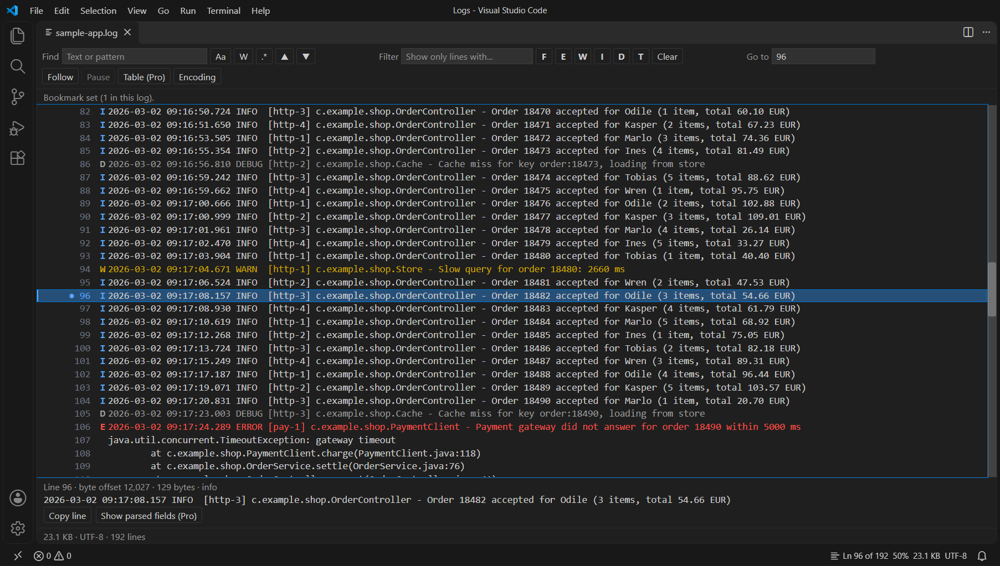
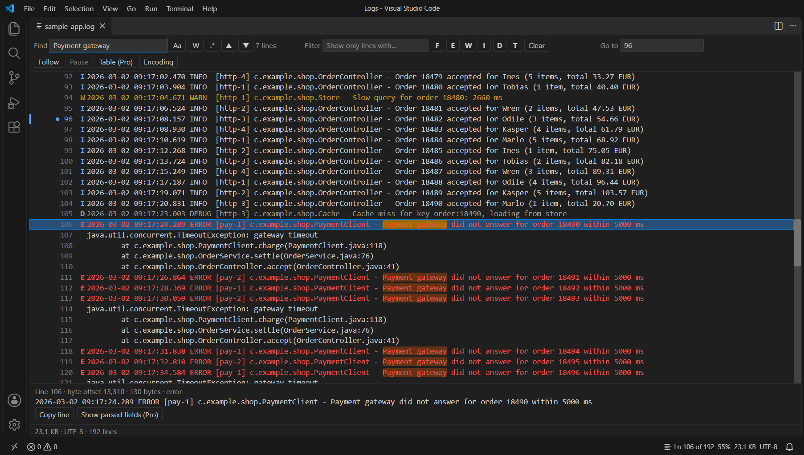
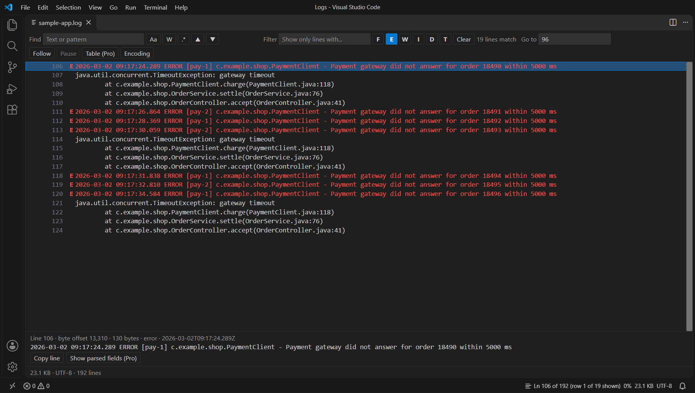
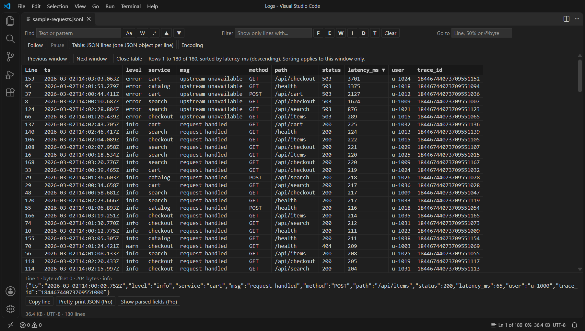
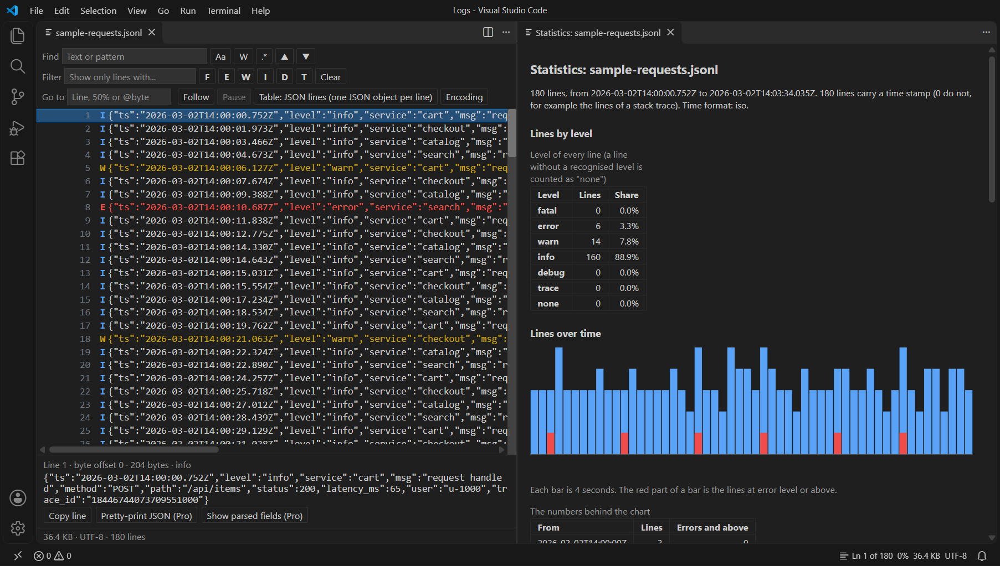

# Big Log Atlas

Open log files of many gigabytes in VS Code without loading them. Scroll, search, filter by level, follow a growing file and jump anywhere in seconds; with Pro, read JSON, logfmt, syslog and web server logs as columns, count errors per minute, merge logs by time, and hand a cleaned-up copy to a colleague. Everything runs on your computer; the only network request is the optional licence check.

## Why

VS Code's own editor refuses or struggles with files above roughly 50 MB, and a log of several gigabytes is routine in operations and support work. Big Log Atlas reads such a file in chunks, keeps a small index of where lines start, and draws only the lines on the screen, so the size of the file hardly changes how fast it opens or how much memory it uses (the index grows slowly with the file: about 0.07 MB for 98 MB and 2.9 MB for 3.98 GB). It never changes the file it shows.

## Free, trial and Pro

| | Free | Pro (14-day free trial, then a key) |
| --- | --- | --- |
| Open logs of any size (Explorer menu or Command Palette), read-only | yes | yes |
| Instant scrolling, jump to a line, a percentage or a byte offset | yes | yes |
| Search with text or regular expression, next and previous, counts of matching lines | yes | yes |
| Level colours with a letter in the margin, time stamp detection (8 formats) | yes | yes |
| Filter by level, text or regular expression (streams, keeps real line numbers) | yes | yes |
| Follow mode (tail) with pause, truncation and rotation detected | yes | yes |
| Bookmarks, copy and select lines, status bar, encodings UTF-8 / UTF-16 / Latin-1 | yes | yes |
| Parse profiles with columns, sortable table, field filters, parsed fields | | yes |
| Time range filter and jump to a time | | yes |
| Statistics: levels, rate over time, most frequent values, error bursts | | yes |
| Merge up to 16 logs by time with a source tag | | yes |
| Saved filters and highlight rules per workspace | | yes |
| Export filtered lines to text, CSV, JSON, JSON Lines (streaming) | | yes |
| Pretty-printed JSON lines in the details pane | | yes |
| Anonymised export (e-mail, IP, tokens, card-like numbers, your own rule file) | | yes |
| Comparison of two log excerpts after normalising times and ids | | yes |

The first Pro command starts a free 14-day trial of every Pro feature on this computer: no key, no account and no network connection are needed. The free features never require a key and will not be moved behind one.

## What it looks like

All data in the pictures is invented (the sample logs that the extension can open for you).

## Measured speed and memory

Measured with the extension's measuring script (`test/helpers/large-run.js`, which the large-file tests also run) on one Windows computer (Node 24, 8 logical processors), with synthetic logs of one line per request that were written just before the measurement (so the operating system's file cache was warm; a cold read is limited by your disk). The extension's JavaScript heap was limited to 300 MB for every run. The 3.98 GB row is a separate run of the same script, outside the test suite. The table was measured before the last fixes of this version; a repeat on a busy computer is in [limits](docs/limits.md). These are measurements, not promises for other machines.

| Log | Lines | Time to show the first lines | Time to index the whole file | Read a random line | Plain text search over all lines | Regular expression over all lines | Level filter over all lines | Peak memory of the process |
| --- | ---: | ---: | ---: | ---: | ---: | ---: | ---: | ---: |
| 98 MB | 1.15 million | 14 ms | 0.11 s | 0.10 ms | 0.39 s | 0.82 s | 0.74 s | 58 MB |
| 986 MB | 11.5 million | 16 ms | 1.6 s | 0.12 ms | 6.2 s | 11.6 s | 9.7 s | 76 MB |
| 3.98 GB | 46 million | 5 ms | 4.4 s (856 MB/s) | 0.10 ms | 18.4 s | 35.5 s | 36.3 s | 85 MB |

The index of the 3.98 GB log holds 179,688 entries (about 2.9 MB), because it keeps one entry for roughly every 256th line or every 256 KB. Growth was detected and 1,000 appended lines were indexed in about 1 ms for the 986 MB and the 3.98 GB logs (only the new part is scanned). A file of 20 GB was not measured: the time to the first lines does not depend on the size of the file, but the time to index it and to search it does, in proportion (see [limits](docs/limits.md)).

## Features in detail

* [Getting started](docs/getting-started.md): opening, the view, keyboard, go to.
* [Searching](docs/searching.md) and [regular expressions](docs/regex.md): an engine without backtracking, with a work limit on every call, so a costly pattern is stopped with a message instead of freezing the editor; patterns that cannot be matched in guaranteed linear time (back-references, look-around) are refused with a message.
* [Filtering](docs/filtering.md): level, text, regular expression, field and time range; limits that are stated, not hidden.
* [Follow mode and bookmarks](docs/follow.md).
* [Time stamps](docs/timestamps.md): the formats, zones, lines without a time stamp, time jump.
* [Parse profiles](docs/profiles.md) (Pro): JSON Lines with exact numbers, logfmt, syslog, access logs, nginx and Apache error logs, log4j and logback patterns, your own pattern.
* [Statistics](docs/statistics.md), [merge by time](docs/merge.md), [export, anonymise and compare](docs/export.md) (Pro).
* [Limits and measured numbers](docs/limits.md), [accessibility](docs/accessibility.md), [troubleshooting](docs/troubleshooting.md), [licence and trial](docs/licence.md).

## Commands

All commands are in the Command Palette under "Big Log Atlas"; the ones marked (Pro) need the trial or a key.

| Command | What it does |
| --- | --- |
| Open As Large Log | Opens a file in the viewer (also in the Explorer's right-click menu) |
| Open Sample Log, Open Sample JSON Lines Log | Open short invented logs |
| Open Getting Started Guide, Show Documentation, Report A Problem | Help; Report A Problem copies a diagnostics block without content, names or paths |
| Go To Line, Percentage Or Byte Offset | `1234`, `50%`, `@1048576`, `0x1F4000`, or `t:` and a time (Pro) |
| Find, Find Next, Find Previous | Search in the open log |
| Filter By Level, Clear Filter | Level filter, remove every filter |
| Follow File (Tail) | Watch a growing file |
| Change Encoding | UTF-8, UTF-16 LE / BE, Latin-1 or automatic |
| Toggle Bookmark On Current Line, Go To Next Bookmark, Go To Previous Bookmark | Bookmarks |
| Copy Selected Lines | Copies the selected lines |
| Choose Parse Profile (Pro) | Reads lines as fields (JSON Lines, logfmt, syslog, access log, ...) |
| Filter By Field (Pro) | `status>=500 path~^/api/` |
| Filter By Time Range (Pro) | Lines between two times |
| Jump To Time (Pro) | First line at or after a time |
| Show Statistics (Pro) | Levels, rate over time, top values, error bursts |
| Merge Log Files By Time (Pro) | Up to 16 files as one stream with a source tag |
| Save Current Filter (Pro), Apply Saved Filter (Pro) | Saved filters per workspace |
| Edit Highlight Rules (Pro) | Coloured parts of lines per workspace |
| Export Filtered Lines (Pro) | Text, CSV, JSON, JSON Lines |
| Export Anonymised Copy (Pro) | Replaces e-mail, IP, tokens, card-like numbers, your rules |
| Compare Two Log Excerpts (Pro) | Side-by-side comparison after normalising times and ids |
| Buy Pro, Enter Licence Key, Show Licence Status, Remove Licence From This Machine | Licence |

## Settings

| Setting | Default | What it does |
| --- | --- | --- |
| `bigLogAtlas.maxLineChars` | 2000 | Characters of a line shown in the list (the details pane shows up to 65,536) |
| `bigLogAtlas.defaultEncoding` | auto | Encoding used when a log is opened |
| `bigLogAtlas.indexCache.maxMB` | 64 | Size cap of the saved line indexes; 0 turns them off |
| `bigLogAtlas.follow.intervalMs` | 500 | How often follow mode looks for new lines |
| `bigLogAtlas.filter.maxMatches` | 2,000,000 | Largest number of lines a filter keeps; a filter that finds more says so |
| `bigLogAtlas.colourLevels` | on | Colour lines by level (the letter in the margin stays) |
| `bigLogAtlas.export.neutraliseFormulas` | on | Put an apostrophe before CSV cells that start with `=`, `+`, `-`, `@`, a tab or a carriage return |

## Licence and price

* **Pro Personal**: USD 29, one-time, for one person (use at work is allowed), up to 3 of that person's computers.
* **Pro Business**: USD 59 per user, one-time; a purchase for N users gives N keys, each for up to 3 computers. **Buy Pro** asks "How many users? (1-100)".
* Keys do not expire. No subscription. The checkout page shows the final price and taxes for your country.
* Payments are handled by Dodo Payments, the merchant of record; invoices and refund requests follow its buyer terms. See [TERMS.md](TERMS.md) and [LICENSE.txt](LICENSE.txt).

## Requirements and what was tested

* Visual Studio Code 1.82 or later. Files on the computer the editor runs on (in a remote window that is the remote machine; not tested); virtual workspaces are not supported.
* Tested: the automated tests (unit, adversarial, seeded random, a corpus of 49 original sample logs, licence and package tests) were run on Windows 11 with Node 24, in several time zones and from a folder whose path has spaces and non-ASCII characters; the finished package was installed in a throw-away copy of VS Code 1.146 with a fresh profile and a stand-in licence service, and a scripted check of the real user interface was run on it. **macOS, Linux, other editor versions, remote windows and the editor forks were not tested.** A workflow for three systems and Node 22 and 24 is prepared in `.github/workflows/ci.yml` but has not been run.
* No dependencies, no native code, no bundled third-party components.

## FAQ

**Does it change my log files?** No. Files are opened for reading only.

**Is my log sent anywhere?** No. There is no telemetry. The extension makes no network request without a licence key; after you enter one, it contacts only `live.dodopayments.com` to activate, validate and release the key. See [PRIVACY.md](PRIVACY.md).

**How can a search be safe from "catastrophic backtracking"?** Regular expressions run on an engine that cannot backtrack: the work for a line is proportional to its length times the size of the pattern, and a work limit stops a call that would need more (with a message that says what to change). The price: back-references and look-around are not supported and are refused with a message. See [regex](docs/regex.md).

**What does "the filter stopped at 2,000,000 matching lines" mean?** A filter keeps its matches in memory (about 8 bytes each), so the list has a cap that you can change in the settings. When a filter finds more, it stops and says so instead of showing an incomplete list as if it were complete.

**Why are lines longer than a million characters special?** Search and filters read the first 1,048,576 characters of a line. A pass that meets a longer line tells you how many such lines it read only in part; nothing is dropped silently.

**Times without a zone: which zone?** UTC, so that ordering never depends on the zone of your computer. Add a zone to a time you type if your log's times are local. See [timestamps](docs/timestamps.md).

**Does the anonymised export remove everything sensitive?** No, and it does not make a log safe to share. It replaces the shapes listed in [export](docs/export.md) under "Covered shapes": values after secret names (in pairs, in name/value pairs, in XML, in command lines, in several encodings), e-mail addresses, IP addresses, card-like numbers and token-like strings, and what your rule file describes. Every listed shape is tested in all eight parse profiles and all four export formats. What it cannot do is listed there too: a secret in free text with no name in front of it, names of people, host names, file names and everything else that does not have one of the listed shapes stay. Open the copy and read it before you share it.

**Can it open compressed logs (.gz)?** No. Extract the file first.

**Old Mac files that end lines with a lone CR?** A lone CR is not a line break; convert the file first.

## For IT and procurement

* Publisher: **Small Steps Studio**, extension id `SmallStepsStudio.big-log-atlas`, Marketplace page <https://marketplace.visualstudio.com/items?itemName=SmallStepsStudio.big-log-atlas>.
* Network: the only host the extension contacts is `live.dodopayments.com` (HTTPS), and only for the licence check after a key has been entered. Without a key, nothing is sent. The 14-day trial uses no network.
* No telemetry, no crash reporting, no analytics, no advertising.
* Data: log contents and file names never leave the machine. Saved on the machine: saved line indexes (offsets and two checksums, no text; optional), bookmarks (line numbers, by hash of the path), saved filters, highlight rules and the last profile pattern typed (workspace storage), the licence key (secret storage) and the trial record. See [PRIVACY.md](PRIVACY.md).
* Source: public repository <https://github.com/small-steps-studio/big-log-atlas>; the package contains plain JavaScript, a page script and a style sheet, no minified or bundled code.
* The extension runs in the extension host (it needs file system access); it executes no code from the logs. The log view puts log text into the page as text only; the statistics page escapes every value it shows.
* Licence terms: [LICENSE.txt](LICENSE.txt), [TERMS.md](TERMS.md). The texts are plain-language and have not been reviewed by a lawyer.

## Names

Log format and tool names in the documentation (syslog, logfmt, JSON Lines, log4j, logback, nginx, Apache and others) are used only to say which formats Big Log Atlas reads. Big Log Atlas is independent: it is not affiliated with, approved by or endorsed by the projects or companies that define or use these formats.

## Support

Questions, bug reports and licence problems: <https://github.com/small-steps-studio/big-log-atlas/issues>. **Report A Problem** in the Command Palette copies a diagnostics block (no log content, no names, no paths) and opens that page. Never post a licence key or confidential log content in a public issue.
